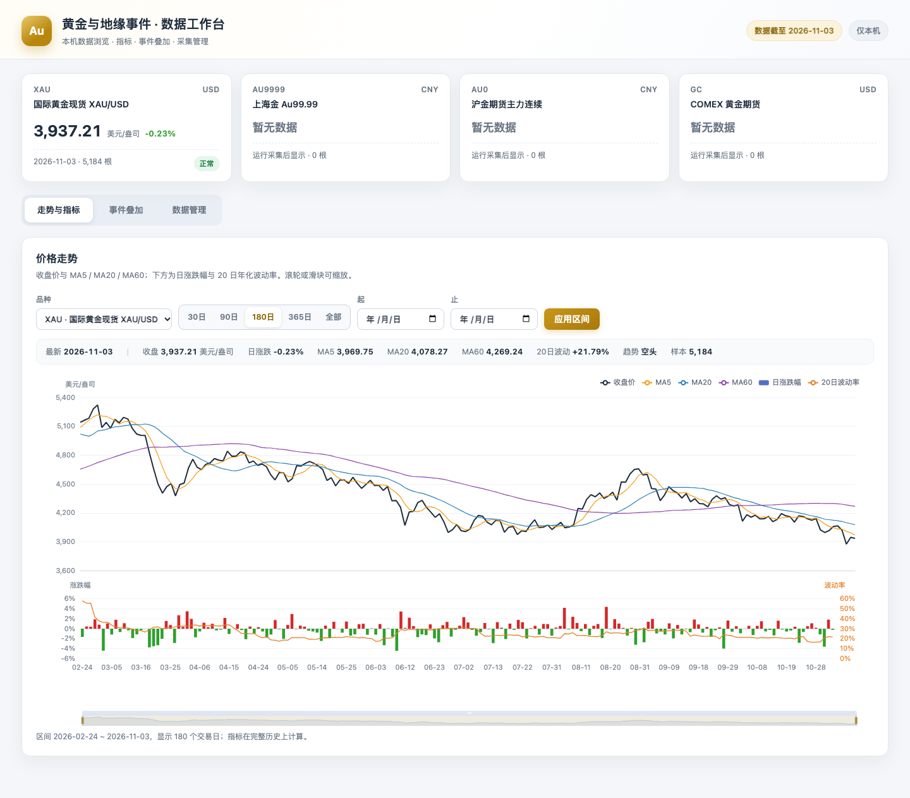
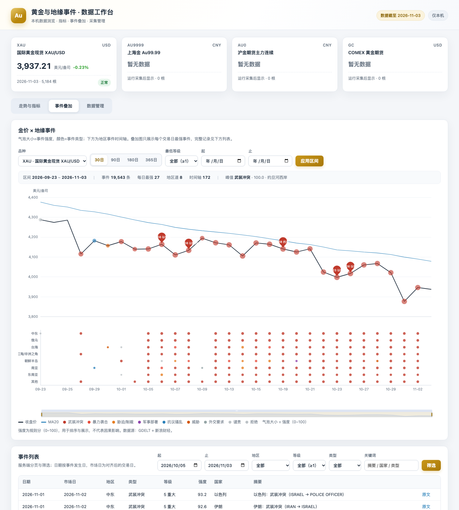
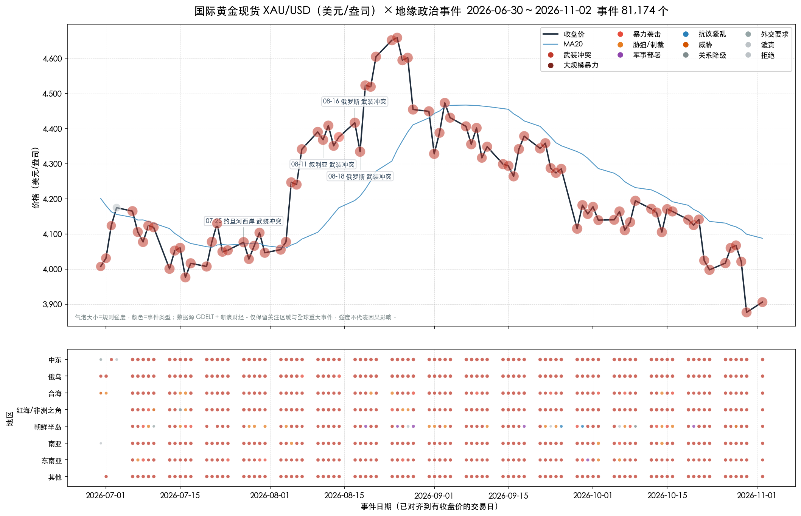

# datastore

用于获取感兴趣的数据。当前包含一个本机运行的**黄金价格趋势跟踪 + 地缘政治事件跟踪**工具。

黄金价格一期（MVP）实现日线数据的采集、存储、指标计算与图表展示，覆盖国内外黄金价格；地缘政治事件一期（P1）接入 GDELT 事件日文件，做关注区域过滤、规则强度、入库、金价叠加图与简单事件窗口统计。盘中实时数据与价格提醒留到后续阶段。

## 功能

- **数据采集**：从免费公开接口抓取日线行情，多个数据源按优先级回退，失败自动重试（指数退避）。
- **数据存储**：SQLite 本地入库，按品种和日期范围查询，重复采集自动去重更新。
- **趋势分析**：MA5 / MA20 / MA60 均线、日涨跌幅、20 日年化波动率、基于均线排列的趋势判断。
- **可视化**：价格与均线走势图，附日涨跌幅柱状图与波动率曲线，输出 PNG。
- **地缘事件**：从 GDELT 采集关注区域与全球重大事件，按 CAMEO 类型和信源等计算可解释强度，入库并与交易日对齐。
- **事件叠加图**：金价走势上叠加事件气泡（大小为强度、颜色为类型），下方按地区分道展示事件时间轴。
- **事件窗口统计**：以 `[-120,-21]` 交易日均值收益为基准，计算事件后 `[0,+1]`、`[0,+3]`、`[0,+5]` 的累计异常收益。
- **本机运行**：纯 Python，无需数据库服务；可用 cron 定时执行。

## 跟踪品种

| 代码 | 品种 | 单位 | 数据源 |
| --- | --- | --- | --- |
| `XAU` | 国际黄金现货 XAU/USD | 美元/盎司 | 新浪财经（全球期货/现货日线） |
| `AU9999` | 上海金 Au99.99 | 元/克 | 上海黄金交易所官网 |
| `AU0` | 沪金期货主力连续 | 元/克 | 新浪财经（国内期货日线） |
| `GC` | COMEX 黄金期货（可选） | 美元/盎司 | 新浪财经，失败回退 Yahoo Finance |

免费数据源无需 API Key，但可能存在延迟、限流或接口调整，详见文末说明。

## 快速开始

要求 Python 3.9+。

```bash
python3 -m venv .venv
source .venv/bin/activate
pip install -r requirements.txt

# 一键：初始化数据库 + 增量采集 + 文本报告 + 图表
python -m goldtrack run
```

首次运行会拉取各品种的全部历史日线（XAU 约 2006 年至今），之后默认增量采集最近几天。

## 常用命令

```bash
# 初始化数据库（data/gold.db）
python -m goldtrack init

# 查看品种与数据源
python -m goldtrack sources

# 采集（默认增量；--full 全量）
python -m goldtrack fetch
python -m goldtrack fetch --symbols XAU,AU9999,AU0 --full

# 按时间范围查询
python -m goldtrack query --symbol XAU --start 2026-01-01 --end 2026-11-02
python -m goldtrack query --symbol XAU --limit 10 --json

# 指标（MA5/MA20/MA60、涨跌幅、波动率、趋势）
python -m goldtrack indicators --symbol AU9999 --limit 20
python -m goldtrack indicators --symbol AU9999 --json

# 图表（默认最近 180 个交易日）
python -m goldtrack chart --symbol XAU --days 180
python -m goldtrack chart --symbol AU0 --out output/charts/au0.png

# 最新趋势报告
python -m goldtrack report

# 地缘政治事件（首次回填最近 30 天，之后默认增量）
python -m goldtrack events fetch
python -m goldtrack events fetch --start 2026-07-05 --end 2026-11-01
python -m goldtrack events query --days 30 --level 3
python -m goldtrack events chart --symbol XAU --days 180
python -m goldtrack events windows --symbol XAU --days 180
```

全局参数 `--db` 可指定数据库路径，`-v` 输出详细日志。

文本报告示例：

```
黄金价格趋势跟踪  数据截至 2026-11-02

品种            最新日期              收盘      日涨跌          MA5         MA20         MA60    20日波动  趋势      样本
-------------------------------------------------------------------------------------------------------------------------
XAU 国际黄金…   2026-11-02        3,903.99      +0.70%     3,985.84     4,087.47     4,275.71     +20.99%  空头      5184
AU9999 上海金…  2026-11-02          836.08      -2.19%       857.08       883.35       926.10     +15.89%  空头      2393
AU0 沪金期货…   2026-11-02          836.76      -2.15%       857.55       884.66       928.50     +16.85%  空头      4581
```

图表示例位于 `output/charts/`：上方为收盘价与 MA5/MA20/MA60，下方为日涨跌幅与 20 日年化波动率。

## 本机 Web UI

除命令行外，项目自带一个仅监听本机的数据工作台（FastAPI + 静态 ECharts，不需要 Node/npm 构建）：

```bash
pip install -r requirements.txt
python -m goldtrack web --port 8000
# 或：python -m goldtrack.web --port 8000
```

打开 <http://127.0.0.1:8000>。默认使用 `data/gold.db`，可用 `--db` 或 `GOLDTRACK_DB` 指定；服务默认只绑定 `127.0.0.1`，本机单用户不做鉴权。

页面包含：

- **走势与指标**：收盘价、MA5/20/60、日涨跌幅与 20 日年化波动率；30/90/180/365 交易日、全部或自定义区间；滚轮/滑块缩放。
- **事件叠加**：金价 + 事件气泡 + 地区时间轴，支持 30/90/180/365 日与最低等级；服务端按「每日最强 / 地区×交易日最强」聚合，避免把数万条事件一次性塞进浏览器。
- **事件列表**：日期、地区、等级、类型、关键词筛选和分页，保留原文链接。
- **数据管理**：品种/事件库最新日期与条数、最近成功/失败采集、手动触发价格增量/全量、事件增量/补采/自定义区间，以及运行进度和历史。

采集在独立子进程执行（避免 GDELT 解析占用 API 进程），任务状态写入 SQLite 的 `collection_runs`，页面轮询进度；同一时间只允许一个采集任务。`scripts/daily.sh` / `scripts/events.sh` 已改为通过 `--record-run` 写入同一张表，因此 cron 采集也会出现在页面的「最近成功/失败」和运行记录中。SQLite 使用 WAL + busy timeout，允许采集写入时继续读取。

主要接口（FastAPI 自动生成 OpenAPI，启动后访问 `/docs`）：

| 接口 | 说明 |
| --- | --- |
| `GET /api/instruments` | 品种元数据与最新快照 |
| `GET /api/prices` | OHLCV + 指标，支持 `days`/`start`/`end`/`max_points` |
| `GET /api/events` | 事件分页与筛选 |
| `GET /api/events/overlay` | 叠加图聚合数据 |
| `GET /api/status` | 数据状态、最近运行、当前任务 |
| `GET /api/jobs`、`GET /api/jobs/{id}` | 运行历史与任务进度 |
| `POST /api/collect` | 启动价格/事件采集（202 + `run_id`） |

公网部署需要自行加反向代理鉴权、HTTPS 和 `POST /api/collect` 限流；默认配置不要直接暴露到公网。





## 定时采集

`scripts/daily.sh` 已封装「增量采集 + 报告 + 图表」，并将输出写入 `logs/daily.log`。`scripts/events.sh` 负责 GDELT 增量采集与 XAU 事件叠加图，可在价格脚本之后执行。

Linux / macOS cron（每个工作日 08:30 执行，路径换成实际项目路径与 Python 绝对路径）：

```cron
30 8 * * 1-5 /Users/you/datastore/scripts/daily.sh
```

macOS 也可用 launchd 定时调用同一脚本。免费日线数据通常在交易日收盘后更新，建议收盘后或次日早晨执行；GDELT 日文件在次日提供，事件脚本可在同一时间运行。

```cron
40 8 * * 1-5 /Users/you/datastore/scripts/events.sh
```

## 指标口径

| 指标 | 口径 |
| --- | --- |
| MA5 / MA20 / MA60 | 收盘价的 5 / 20 / 60 日简单移动平均 |
| 日涨跌幅 | `(收盘 / 前一收盘 - 1) × 100%` |
| 20 日年化波动率 | 近 20 个交易日对数收益率标准差（样本标准差）× `√252` × 100% |
| 趋势 | 收盘 > MA20 > MA60 且 MA5 ≥ MA20 为「多头」；反向为「空头」；其余为「震荡」；均线未形成时为「数据不足」 |

## 地缘政治事件跟踪（P1）

### 数据源与采集

事件来自 [GDELT Project](https://www.gdeltproject.org/) 的日事件文件（`data.gdeltproject.org/events/YYYYMMDD.export.CSV.zip`），免费、无需 API Key。P1 按日粒度采集，与日线价格对齐；选择日归档而非 15 分钟文件，是因为一次请求覆盖全天、回填 180 天只需 180 个请求（15 分钟文件约需 1.7 万个），且日粒度才与金价日线严格对应。GDELT 2.0 的 15 分钟实时文件留给后续提醒阶段。事件以 `(source, source_event_id)` 幂等去重，重复采集只更新统计字段。

默认只保留：

- `IsRootEvent=1` 且 CAMEO 根码 10–20（要求、谴责、威胁、抗议、军事部署、胁迫/制裁、袭击、冲突、大规模暴力）；
- 关注区域（中东、俄乌、台海、红海/非洲之角、朝鲜半岛、南亚、东南亚）且至少 `--min-sources 3` 个独立信源；
- 或全球重大冲突（根码 19/20）且至少 `--global-min-sources 10` 个信源。

可用 `--all-countries`、`--min-sources`、`--min-intensity` 调整过滤。

`events fetch` 默认从已存最新源日期前一天续采到昨天（GDELT 日文件通常在次日提供）；空库时回填 `--days`（默认 30）天。单日失败只记录，不中断其余日期。

### 事件强度（0–100 规则分）

| 分项 | 上限 | 口径 |
| --- | --- | --- |
| 类型严重度 | 30 | CAMEO 根码：20/19=30，18=27，17=24，15=21，13/16=18，14=15，10–12=9 |
| 规模 | 20 | `min(|GoldsteinScale| / 10, 1) × 20` |
| 传播广度 | 25 | `min(log1p(NumSources) / log1p(50), 1) × 25` |
| 负面语气 | 10 | `min(max(-AvgTone, 0) / 10, 1) × 10` |
| 区域权重 | 15 | 中东/俄乌 15，台海 14，红海/朝鲜半岛 12，南亚 10，东南亚 8，其他 5 |

等级：≥90 重大(5)、≥75 显著(4)、≥60 关注(3)、≥40 一般(2)、其余轻微(1)。分项与总分都入库；强度不是市场冲击，基于历史基线的升级程度 z-score 留到 P2。

### 时间对齐与窗口统计

- 事件发生日按日期保存；周末/节假日事件顺延到下一个有收盘价的交易日（market date），窗口按交易日而非自然日计算。
- 窗口统计使用均值调整异常收益：估计窗口 `[-120,-21]` 个交易日，事件窗口 `[0,+1]`、`[0,+3]`、`[0,+5]`；结果写入 `event_impacts`，并按窗口和等级汇总平均/中位 CAR 与 CAR>0 占比。
- 这是描述性统计，不是因果结论；同日多事件、事件聚集、遗漏变量（美元、实际利率、VIX）都会影响解读，控制变量回归与聚类标准误属于 P2。
- 叠加图中，价格面板每个交易日只画当天最强的一个事件，下方时间轴按「地区 × 交易日」各画最强事件，避免数千个气泡互相遮挡；完整事件仍全部保留在数据库中，可用 `events query` 查看。

### 事件相关命令

```bash
# 增量采集（首次空库回填 30 天）
python -m goldtrack events fetch

# 指定区间回溯（每天一个日文件，约数秒）
python -m goldtrack events fetch --start 2026-08-01 --end 2026-10-31

# 查询（默认最近 90 天、最多 30 条；limit 取最近日期、同日优先高强度；--level 只看等级）
python -m goldtrack events query --days 30 --level 3
python -m goldtrack events query --region 中东 --json

# 金价 + 事件叠加图
python -m goldtrack events chart --symbol XAU --days 180

# 事件窗口统计（默认写入 event_impacts）
python -m goldtrack events windows --symbol XAU --days 180
```

XAU 最近 90 个交易日的真实叠加图示例：



### 事件表

`events` 保存 `source/source_event_id/occurred_at/published_at/region/country/type/level/intensity` 及分项、经纬度、摘要、URL 与原始行 JSON；`event_impacts` 保存每个事件、品种、窗口的市场日、估计窗口、基准收益与 CAR。两张表由 `python -m goldtrack init` 或任意读写命令自动创建。

## 目录结构

```
goldtrack/
├── cli.py            # 命令行入口
├── config.py         # 路径与图表参数
├── db.py             # SQLite 存储与查询
├── fetch.py          # 多源采集、重试与增量写入
├── indicators.py     # 均线、涨跌幅、波动率、趋势
├── instruments.py    # 品种与数据源注册表
├── models.py         # Bar / Instrument 等数据模型
├── report.py         # 终端趋势报告
├── chart.py          # Matplotlib 图表
├── web/              # 本机 Web UI（FastAPI + 静态 ECharts）
├── sources/          # 新浪财经、上金所、Yahoo 数据源
└── events/           # GDELT 采集、过滤、强度、窗口统计与叠加图
scripts/daily.sh      # 价格定时任务脚本
scripts/events.sh     # 事件定时任务脚本（需先有价格数据）
tests/                # pytest 单元测试（全部离线）
```

## 测试

```bash
pip install -r requirements-dev.txt
python -m pytest -q
```

测试不访问网络：数据源解析使用 `tests/fixtures/` 中的固定响应，采集重试/回退使用假数据源；Web API 使用 FastAPI `TestClient` 与临时 SQLite。

## 数据源与限制

- 免费接口适合个人研究与趋势观察，不保证实时性或可用性；接口限流、字段变化时可能需要调整解析。
- GDELT 同一事件会因不同报道重复出现，P1 仅按事件 ID 去重、按交易日聚合展示；事件簇/去重与更严格的统计检验属于 P2。GDELT 的收录时间不等于发生时间，事件日期使用 `Day` 字段，回溯数据可能包含更早发生的事件。
- 事件强度是规则分，只能用于排序和展示，不应当作市场冲击或因果证据。
- XAU 为国际现货黄金报价，`AU9999` 为上海金基准价，`AU0` 为沪金主力连续，`GC` 为 COMEX 期货；不同品种的计价单位与交易时段不同，报告与图表按品种分别展示，不做跨品种换算。
- 主力连续合约换月会产生跳空，长期均线分析时需留意。
- 本工具仅用于数据整理与趋势参考，不构成任何投资建议。

## 后续计划

- P2：ACLED/UCDP 交叉校验、事件去重/聚类、基于历史基线的升级程度、控制变量事件研究（VIX、美元指数、实际利率）、bootstrap 与安慰剂检验。
- P3：GDELT 2.0 15 分钟轮询、重大事件提醒（阈值、去重、冷却，避免告警风暴）。
- 盘中 / 实时行情采集与刷新；价格突破提醒；更多指标、回测与跨品种价差分析。
