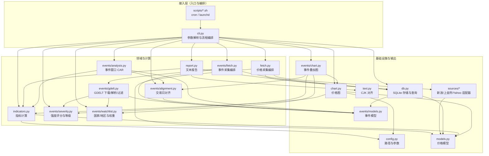
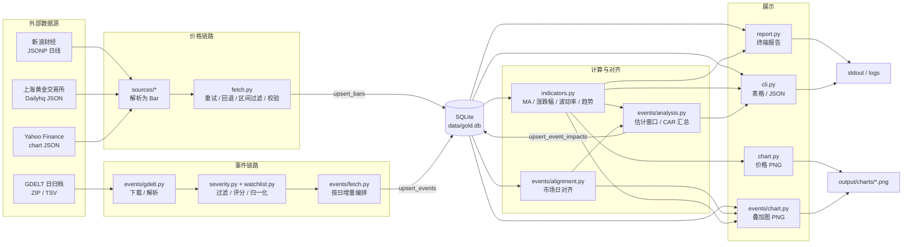
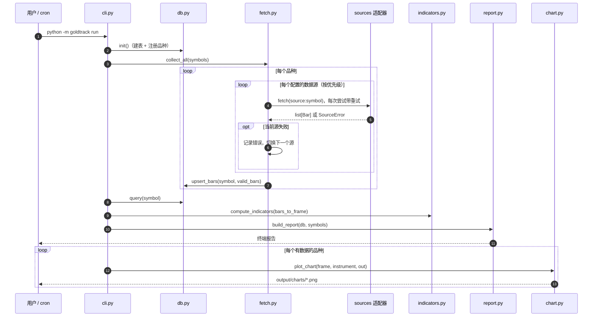
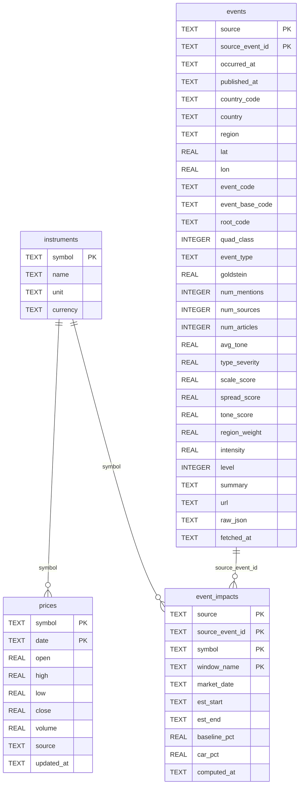
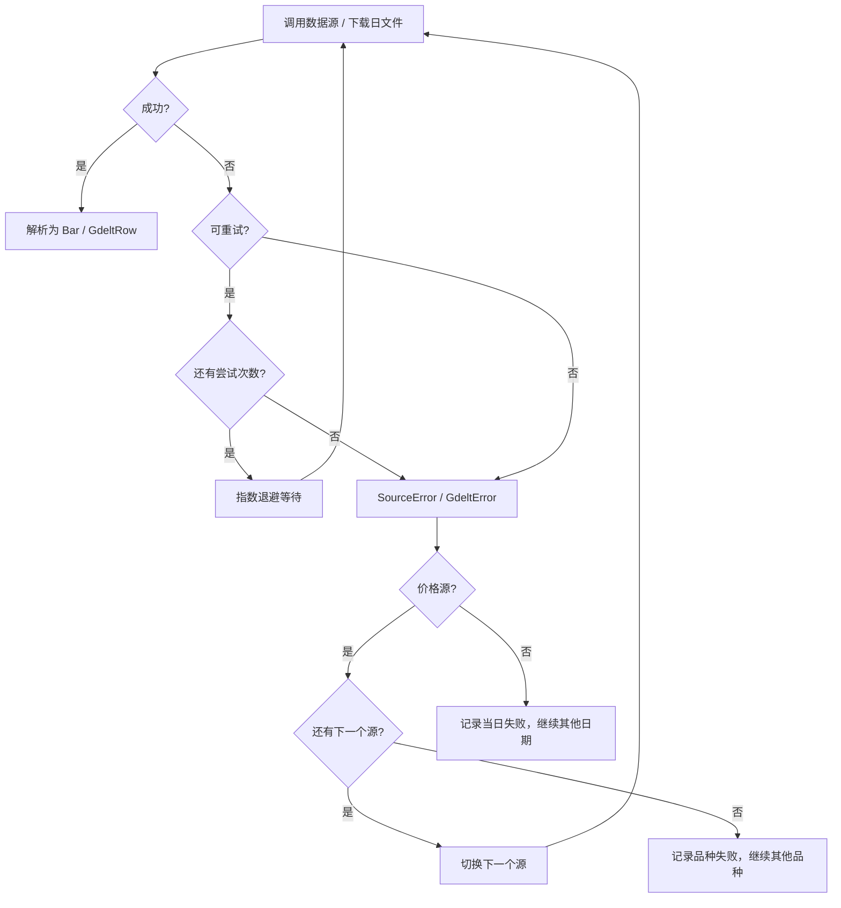
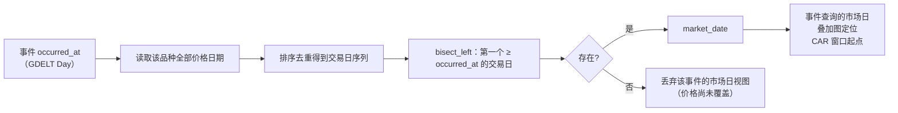
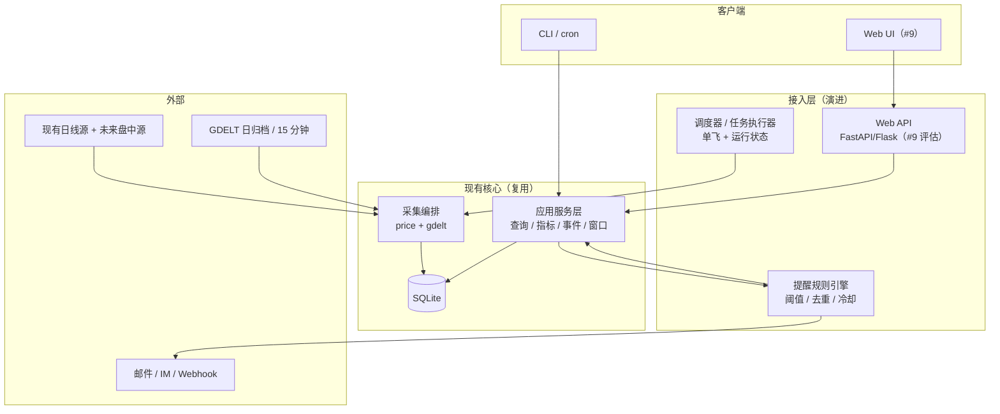

# datastore 系统架构设计

| 项目 | 内容 |
| --- | --- |
| 文档状态 | v1（P1 基线） |
| 代码基线 | `master` @ `13ddb1a`（2026-11-03） |
| 适用系统 | 黄金日线趋势跟踪 + GDELT 地缘政治事件跟踪 |
| 维护方式 | 架构变更时同步更新本文；新增模块、表结构、外部依赖或统计口径变化都应在此留下记录。 |

## 1. 文档说明

### 1.1 目的

本文档沉淀 datastore 当前（P1）的设计，说明模块边界、数据如何流动、数据如何存储、依赖哪些外部服务、关键统计口径为什么这样定，以及后续 Web 前端、实时采集和提醒功能可以从哪里接入。它面向维护者与后续功能的实现者，不替代 README 中的使用说明。

### 1.2 范围与基线

本文描述的是当前 `master` 上已经实现的系统：

- 黄金等品种的**日线**采集、SQLite 入库、指标计算、文本报告与静态图表；
- GDELT 日归档事件的采集、过滤、强度评分、入库、交易日对齐、叠加图与事件窗口统计；
- `python -m goldtrack` 命令行及其 cron/launchd 脚本。

Web 前端（#9）、盘中实时行情、提醒、P2 统计增强尚未合入当前基线，只在第 7 节作为演进方向讨论。若这些功能已经合入而本文未更新，以代码和对应 PR 为准。

### 1.3 非目标

当前架构明确不解决以下问题：

- 多用户、公网部署、鉴权与权限隔离；
- 高并发写入或水平扩展；
- 盘中/逐笔行情与低延迟推送；
- 因果推断、交易信号或投资建议；
- 跨品种单位换算与套利定价；
- 历史数据的完整审计与上游删除同步。

这些非目标决定了当前许多“简单优先”的取舍，第 6 节会逐项说明。

### 1.4 术语

| 术语 | 含义 |
| --- | --- |
| 品种 / Instrument | 被跟踪的黄金相关标的，如 `XAU`、`AU9999`、`AU0`、`GC` |
| Bar | 一根日线 OHLCV 数据 |
| 交易日 / Market date | 某个品种实际有收盘价的日期，由已入库价格推导，不是交易所日历 |
| 事件 / GeoEvent | 经过 GDELT 过滤、评分、归一化后的地缘政治事件 |
| 事件日期 / `occurred_at` | GDELT `Day` 字段表示的事件发生日 |
| 源日期 / `published_at` | GDELT 日归档文件对应的日期，用于增量续采 |
| 强度 / Intensity | 0–100 的可解释规则分，不是市场冲击或概率 |
| CAR | 累计异常收益（Cumulative Abnormal Return），这里指均值调整后的交易日累计收益 |
| P1 / P2 / P3 | 一期（当前）、二期（分析增强）、三期（实时与提醒） |

## 2. 总体架构

### 2.1 架构风格

当前系统是一个**模块化单体（modular monolith）**，不是服务化系统：

- 一个 Python 包 `goldtrack`，每个命令启动一个短生命周期进程；
- CLI 是组合根（composition root），负责解析参数、装配 `Database`、调用采集/计算/展示模块；
- 领域模块不依赖 CLI，也不解析命令行参数；
- 没有常驻服务、消息队列或内部 RPC；进程边界只有外部 HTTP 请求和 SQLite 文件；
- 所有输出是本地文件（SQLite、PNG、日志）或标准输出，默认单机单用户运行。

这种形态适合“每天跑一次、结果落盘”的个人研究工具。它的扩展点主要不在进程内拆分，而在**数据模型、采集适配器和应用服务边界**：后续 Web API 应作为 CLI 的并列适配器复用同一批查询与计算函数，而不是复制一套业务逻辑。

### 2.2 模块划分

| 模块 | 主要文件 | 职责 | 关键接口 / 数据 |
| --- | --- | --- | --- |
| 入口与编排 | `cli.py`、`__main__.py` | 解析子命令与参数，装配数据库，串起采集、查询、指标、图表、报告与事件命令 | `main(argv)`、`build_parser()`、各 `cmd_*` |
| 配置 | `config.py` | 数据库与图表输出路径、图表尺寸、年化交易日数 | `DEFAULT_DB_PATH`、`DEFAULT_CHART_DIR`、`ANNUAL_TRADING_DAYS=252` |
| 核心模型 | `models.py`、`events/models.py` | 价格、品种、采集结果、GDELT 行、事件、事件影响等数据结构 | `Bar`、`Instrument`、`FetchResult`、`GdeltRow`、`GeoEvent`、`EventImpact` |
| 品种注册 | `instruments.py` | 维护品种元数据与按优先级排列的数据源规格 | `INSTRUMENTS`、`DEFAULT_SYMBOLS`、`get_instrument()` |
| 数据源适配 | `sources/` | 把新浪、上金所、Yahoo 的响应解析为 `Bar`；提供 HTTP、重试与错误分类 | `DataSource.fetch()`、`resolve("source:symbol")`、`call_with_retry()` |
| 价格采集编排 | `fetch.py` | 按品种逐源回退、重试、增量区间计算、Bar 校验与写入 | `collect_instrument()`、`collect_all()` |
| 存储 | `db.py` | 建表、连接管理、价格/事件/事件影响的 upsert 与查询 | `Database.init/upsert_bars/query/upsert_events/query_events/upsert_event_impacts` |
| 指标 | `indicators.py` | K 线转 DataFrame、均线、日涨跌幅、年化波动率、趋势分类 | `bars_to_frame()`、`compute_indicators()`、`latest_snapshot()` |
| 展示 | `report.py`、`chart.py`、`text.py` | 终端趋势报告、价格图表、CJK 宽度对齐 | `build_report()`、`plot_chart()`、`render_table()` |
| 事件采集 | `events/fetch.py`、`events/gdelt.py` | 按日增量编排、下载 ZIP、解析 58/61 列 TSV、过滤与评分 | `collect_events()`、`fetch_export()`、`parse_export()`、`build_events()` |
| 事件规则 | `events/severity.py`、`events/watchlist.py` | CAMEO 类型映射、强度分项、等级阈值、FIPS 国家/地区映射与区域权重 | `intensity_score()`、`level_for()`、`country_region()` |
| 事件对齐与分析 | `events/alignment.py`、`events/analysis.py` | 事件日到交易日的对齐、估计窗口与事件窗口 CAR、汇总 | `align_market_date()`、`compute_event_impacts()`、`summarize_impacts()` |
| 事件图 | `events/chart.py` | 金价 + 事件气泡 + 地区时间轴叠加图 | `plot_event_chart()` |
| 运维脚本 | `scripts/daily.sh`、`scripts/events.sh` | 封装 cron/launchd 的价格与事件任务，输出到 `logs/` | shell 入口 |

### 2.3 模块依赖关系



依赖规则：

1. **入口层只做装配与编排**。`cli.py` 可以依赖所有领域模块，但领域模块不反向依赖 `cli.py`。
2. **价格与事件共享存储，但不共享实体模型**。`db.py` 同时导入 `models.py` 和 `events/models.py`，把两类实体映射到 SQLite；这是当前唯一一处“存储层知道领域模型”的耦合，换来的是无需 ORM 的简单实现。
3. **数据源被协议隔离**。`sources/base.py` 定义 `DataSource` 协议与重试策略，具体源只负责“给 symbol，返回排序后的 `Bar`”，便于离线测试时注入假源。
4. **事件计算与价格计算只共享 `indicators.py` 的 DataFrame 约定**。`events/analysis.py` 复用 `bars_to_frame()`，避免两套收益率口径。
5. 无循环依赖；`events/chart.py` 复用 `chart.py` 的字体配置，但价格图不依赖事件模块。

### 2.4 运行形态

| 形态 | 说明 |
| --- | --- |
| 交互式 CLI | `python -m goldtrack <command>`；进程内顺序执行，退出即结束 |
| 定时任务 | `scripts/daily.sh` 调 `goldtrack run`；`scripts/events.sh` 先 `events fetch` 再 `events chart --symbol XAU`；输出追加到 `logs/*.log` |
| 存储 | 单个 SQLite 文件，默认 `data/gold.db`，可用 `--db` 或 `GOLDTRACK_DB` 覆盖 |
| 图表输出 | 默认 `output/charts/`，可用 `GOLDTRACK_CHART_DIR` 覆盖；PNG 文件名包含品种、数据截止日与天数 |
| 运行环境 | Python 3.9+，macOS/Linux；matplotlib 使用 `Agg` 后端，不要求图形界面 |

一个进程内没有后台线程或子进程；cron 可能让价格任务与事件任务几乎同时运行，二者通过 SQLite WAL 和 `busy_timeout` 串行化写入（见 4.1）。当前没有“任务状态表”，运行结果只体现在日志、标准输出和数据库日期上。

### 2.5 目录结构

```text
goldtrack/
├── cli.py                 # 命令行入口与流程编排
├── config.py              # 路径、图表参数、年化交易日
├── db.py                  # SQLite schema、连接、upsert 与查询
├── fetch.py               # 价格多源采集、重试、回退、增量写入
├── indicators.py          # MA、日涨跌幅、年化波动率、趋势
├── instruments.py         # 品种与数据源注册表
├── models.py              # Bar / Instrument / FetchResult
├── report.py              # 终端趋势报告
├── chart.py               # 价格与指标图表
├── text.py                # CJK 宽度感知的终端表格
├── sources/
│   ├── base.py            # DataSource 协议、RetryPolicy、错误分类
│   ├── http.py            # requests 封装与统一超时/UA
│   ├── sina.py            # 新浪全球/国内期货日线
│   ├── sge.py             # 上海黄金交易所 Dailyhq
│   └── yahoo.py           # Yahoo Finance chart 回退源
└── events/
    ├── models.py          # GDELT 行、GeoEvent、EventImpact、采集摘要
    ├── gdelt.py           # 日归档下载、ZIP/TSV 解析、过滤与建事件
    ├── severity.py        # CAMEO 类型、强度分项、等级
    ├── watchlist.py       # FIPS 国家、地区、区域权重
    ├── fetch.py           # 事件增量采集编排
    ├── alignment.py       # 事件日 → 交易日
    ├── analysis.py        # 估计窗口、CAR、汇总
    └── chart.py           # 事件叠加图
scripts/daily.sh           # 价格定时任务
scripts/events.sh          # 事件定时任务（依赖已有价格数据）
tests/                     # pytest，全部离线，使用 fixtures 与假数据源
docs/                      # 架构文档与视觉证据
```

## 3. 数据流

### 3.1 端到端总览

价格链路与事件链路在采集阶段彼此独立，在存储之后汇合：



### 3.2 价格链路

1. **入口**：`python -m goldtrack fetch|run` 进入 `cmd_fetch` / `cmd_run`。两者都先调用 `Database.init(INSTRUMENTS.values())`，因此空库或新 checkout 也能直接运行。
2. **确定区间**：`collect_all()` 逐品种调用 `collect_instrument()`。若没有显式 `--start` 且不是 `--full`，起点取该品种库内最新日期减 `DEFAULT_OVERLAP_DAYS=5` 个自然日；否则用 `--start` / `--full` 的语义。
3. **逐源采集**：按 `instrument.sources` 的顺序（如 `GC` 为 `sina_global:GC` → `yahoo:GC=F`）调用 `sources.resolve()` 和 `source.fetch()`。HTTP 层统一使用浏览器 UA、30 秒超时；新浪另带 Referer。
4. **解析**：各适配器把 JSONP / JSON 响应转成按日期升序的 `Bar` 列表；缺失的开高低回退到收盘价，成交量为空时记为 0。
5. **重试与回退**：每次 `fetch()` 包在 `call_with_retry()` 中。仅网络异常、`FetchError`、`SourceError` 视为可重试；默认最多尝试 3 次，退避 1s、2s，单次延迟上限 8s。某个源最终失败时记录错误并尝试下一个源；全部源失败则该品种记失败，但不影响其他品种。
6. **过滤与校验**：只保留 `[effective_start, end]` 内的 Bar；`Bar.problem()` 拒绝无日期、收盘价 ≤ 0、开高低异常、`high < low` 的记录。某源返回的区间内数据全部无效时，按该源失败处理并继续下一个源。
7. **入库**：`db.upsert_bars()` 以 `(symbol, date)` 为自然键执行 `INSERT ... ON CONFLICT ... DO UPDATE`，覆盖 OHLCV、`source` 和 `updated_at`；重复采集不会产生重复行。
8. **读取与计算**：`db.query()` 按 `symbol` 和闭区间日期查询，`bars_to_frame()` 排序去重后交给 `compute_indicators()`。
9. **展示**：`report.py` 输出各品种最新指标文本；`chart.py` 输出价格/均线/涨跌幅/波动率 PNG；`query`、`indicators` 可直接输出 JSON。

### 3.3 事件链路

1. **确定区间**：`events fetch` 进入 `collect_events()`。`resolve_range()` 把结束日截到“昨天（UTC）”，因为 GDELT 日文件通常次日才可下载；未显式指定起点时，从库内最新 `published_at`（源文件日期）减 1 天续采，空库则回填 `--days`（默认 30）个自然日。
2. **按日下载**：对区间内每一天调用 `gdelt.fetch_export(day)`，请求 `https://data.gdeltproject.org/events/YYYYMMDD.export.CSV.zip`，超时 90 秒。
3. **解析**：`parse_export_bytes()` 解压 ZIP，读取 `.CSV` 文件，`parse_export()` 按列数识别 GDELT 1.0 日归档（58 列）或 GDELT 2.0 15 分钟文件（61 列），抽出事件 ID、`Day`、CAMEO 码、Goldstein、信源数、语气、地理位置和 URL，得到 `GdeltRow`。格式不合法或没有可解析行会被视为错误。
4. **过滤与评分**：`build_events()` 只保留根事件、CAMEO 根码 10–20、达到信源阈值的事件；关注区域外的事件只有满足“全球重大冲突（根码 19/20 且信源数 ≥ `--global-min-sources`）”才保留（除非 `--all-countries`）。随后用 `severity.py` 计算 0–100 强度和 1–5 等级，并用 `watchlist.py` 补国家中文名与地区。`--min-intensity` 在评分后过滤。
5. **入库**：`db.upsert_events()` 以 `(source, source_event_id)` 为自然键 upsert；重复采集同一天会更新强度、覆盖度、摘要和 `fetched_at`，不会重复插入。
6. **读取与对齐**：`events query` / `events chart` / `events windows` 从 `events` 表按日期、地区、等级、强度筛选；用该品种已入库价格日期生成交易日序列，`align_market_date()` 把事件映射到“事件日当天或之后第一个有收盘价的交易日”。
7. **展示与分析**：`events/chart.py` 生成叠加图；`events/analysis.py` 计算每个事件、品种、窗口的 CAR，并汇总为按窗口/等级的均值、中位数与 CAR>0 占比；`events windows` 可选择写入 `event_impacts`。

### 3.4 读取、计算与展示链路

| 命令 | 读取 | 计算 | 输出 |
| --- | --- | --- | --- |
| `query` | `prices` | 无 | 表格或 JSON |
| `indicators` | `prices` | `compute_indicators()` | 表格或 JSON |
| `report` | `prices` | 指标 + `latest_snapshot()` | 终端报告 |
| `chart` | `prices` | 指标 + `plot_chart()` | PNG |
| `events query` | `events` + 该品种价格日期 | 市场日对齐 | 表格或 JSON |
| `events chart` | `events` + `prices` | 对齐 + 每日/地区聚合 | PNG |
| `events windows` | `events` + `prices` | 估计窗口 + CAR + 汇总 | 表格或 JSON，默认写 `event_impacts` |

### 3.5 一次 `run` 的时序



### 3.6 失败与部分成功

- **价格**：失败粒度是“品种 × 数据源”。单源失败会继续下一个源；单品种失败不会中断其他品种；`fetch` / `run` 只要有品种失败就返回退出码 1，但已成功的品种照常入库和展示。
- **事件**：失败粒度是“日”。某天 404、解析失败或网络失败只记录到 `EventFetchSummary`，其他日期继续；`events fetch` 只要有失败日就返回 1。
- **无跨表事务**：一次价格采集与一次事件采集互不绑定。进程中断时，已经提交的批次保留，未提交的当前批次由 SQLite 回滚；重跑依靠 upsert 幂等收敛。
- **读取命令自建表**：所有命令通过 `_db()` 调用 `init()`，因此对空库执行 `query` / `report` 不会因缺表崩溃，只会得到“无数据”的结果。

## 4. 存储设计

### 4.1 SQLite 运行参数

| 设置 | 值 | 说明 |
| --- | --- | --- |
| 数据库 | 单文件 SQLite | 默认 `data/gold.db`；无需数据库服务 |
| `journal_mode` | `WAL` | 在 `Database.init()` 中设置，写入数据库文件后持久生效；允许读与写并发，但写者仍只有一个 |
| `synchronous` | `NORMAL` | 每个连接设置；本地工具在 WAL 下可接受，断电可能丢失最近事务，但数据库保持一致性 |
| `busy_timeout` | `30000` ms | 写锁竞争时等待最多 30 秒，避免立即报 `database is locked` |
| 连接 | 每次操作新建、短生命周期 | `Database.connect()` 是上下文管理器；正常退出 `commit()`，异常时关闭并回滚未提交事务 |
| 外键 | 未启用 | 表间关系由代码维护；不依赖 SQLite 外键约束 |
| 迁移 | 无版本化迁移 | `CREATE TABLE IF NOT EXISTS`；当前唯一的历史兼容动作是删除冗余索引 |

### 4.2 逻辑模型



> 图中的关系是**逻辑关系**，数据库没有启用外键约束。`instruments` 是品种元数据的镜像；实际采集时以 `instruments.py` 中的注册表为准。`events` 与 `event_impacts` 通过 `(source, source_event_id)` 关联。

### 4.3 表结构

#### 4.3.1 `instruments`

| 列 | 类型 | 约束 / 说明 |
| --- | --- | --- |
| `symbol` | TEXT | 主键，如 `XAU` |
| `name` | TEXT | 展示名，如“国际黄金现货 XAU/USD” |
| `unit` | TEXT | 计价单位，如“美元/盎司”“元/克” |
| `currency` | TEXT | `USD` / `CNY` |

`Database.init()` 用 `ON CONFLICT(symbol) DO UPDATE` 刷新元数据。该表主要供外部查询/未来 API 使用，采集流程本身从 `instruments.py` 取配置。

#### 4.3.2 `prices`

| 列 | 类型 | 约束 / 说明 |
| --- | --- | --- |
| `symbol` | TEXT | 与 `date` 组成复合主键 |
| `date` | TEXT | ISO-8601 日期，交易日 |
| `open` / `high` / `low` / `close` | REAL | OHLC，`close > 0` |
| `volume` | REAL | 默认 0；上金所等无成交量源为 0 |
| `source` | TEXT | 最近一次成功写入的 `source.name:source_symbol`，用于排查 |
| `updated_at` | TEXT | UTC ISO-8601 时间，行级最后写入时间 |

主键 `(symbol, date)` 同时承担唯一约束与查询索引；旧版本显式创建的 `idx_prices_symbol_date` 已在 `SCHEMA` 中通过 `DROP INDEX IF EXISTS` 移除，避免重复写放大。

#### 4.3.3 `events`

| 列组 | 列 | 说明 |
| --- | --- | --- |
| 主键与时间 | `source`, `source_event_id` | 复合主键；`source` 当前为 `gdelt`，为将来接入 ACLED/UCDP 预留 |
| 主键与时间 | `occurred_at`, `published_at`, `fetched_at` | 事件发生日、源文件日期、入库时间（UTC ISO） |
| 地点 | `country_code`, `country`, `region`, `lat`, `lon` | FIPS 国家码、中文国家名、关注区域与经纬度 |
| CAMEO | `event_code`, `event_base_code`, `root_code`, `quad_class`, `event_type`, `goldstein` | 事件分类与 Goldstein 量表值 |
| 覆盖度/语气 | `num_mentions`, `num_sources`, `num_articles`, `avg_tone` | GDELT 的提及数、信源数、文章数、平均语气 |
| 强度分项 | `type_severity`, `scale_score`, `spread_score`, `tone_score`, `region_weight`, `intensity`, `level` | 五维规则分、总分（0–100）、显示等级（1–5） |
| 展示/追溯 | `summary`, `url`, `raw_json` | 中文摘要、原文链接、解析后 `GdeltRow` 的 JSON |

索引：

- `idx_events_occurred(occurred_at)`：按日期范围查询；
- `idx_events_region_date(region, occurred_at)`：按地区 + 日期筛选；
- 主键 `(source, source_event_id)`：upsert 冲突定位。

没有为 `level`、`intensity` 单独建索引；当前查询先用日期/地区缩小范围，再在剩余行上过滤等级和强度，规模可接受。若事件量继续增长，可评估 `(occurred_at, intensity)` 或 `(region, occurred_at, intensity)` 组合索引。

#### 4.3.4 `event_impacts`

| 列 | 类型 | 说明 |
| --- | --- | --- |
| `source`, `source_event_id` | TEXT | 事件标识，与 `events` 逻辑关联 |
| `symbol` | TEXT | 被分析的价格品种 |
| `window_name` | TEXT | `0,+1`、`0,+3`、`0,+5` |
| `market_date` | TEXT | 对齐后的交易日 |
| `est_start`, `est_end` | TEXT | 估计窗口的首尾交易日（`-120`、`-21`） |
| `baseline_pct` | REAL | 估计窗口日均收益（百分比） |
| `car_pct` | REAL | 事件窗口累计异常收益（百分比） |
| `computed_at` | TEXT | UTC ISO-8601 计算时间 |

主键 `(source, source_event_id, symbol, window_name)` 保证同一事件、品种、窗口只有一行；`idx_event_impacts_symbol(symbol, window_name)` 支持按品种/窗口读取。

### 4.4 索引与典型查询路径

| 查询 | SQL 形状 | 使用的索引 | 备注 |
| --- | --- | --- | --- |
| 某品种区间价格 | `WHERE symbol=? AND date>=? AND date<=? ORDER BY date` | `prices` 主键 | 主键列序与过滤/排序一致 |
| 某品种最新日期 | `MAX(date) WHERE symbol=?` | `prices` 主键 | 用于增量起点 |
| 事件日期范围 | `WHERE occurred_at BETWEEN ? AND ?` | `idx_events_occurred` | 默认按最早到最晚返回 |
| 事件地区 + 日期 | `WHERE region IN (...) AND occurred_at BETWEEN ? AND ?` | `idx_events_region_date` | 地区为前导列 |
| 事件最新 N 条 | 子查询按 `occurred_at DESC, intensity DESC, source_event_id DESC LIMIT ?`，外层再按升序 | `idx_events_occurred` | 先取最新日期，再在日期内取最强事件；避免全量物化 |
| 事件影响 | `WHERE symbol=? [AND window_name=?] ORDER BY market_date, window_name` | `idx_event_impacts_symbol` | PK 也覆盖事件+品种+窗口 |

### 4.5 去重与幂等策略

| 写操作 | 自然键 | 冲突动作 | 重复执行的效果 | 不处理的情况 |
| --- | --- | --- | --- | --- |
| `upsert_bars` | `(symbol, date)` | 覆盖 OHLCV、`source`、`updated_at` | 同一批数据重复写入结果一致 | 上游删除/下架某天数据时，本地旧行保留 |
| `upsert_events` | `(source, source_event_id)` | 覆盖除主键外的全部列（含强度、等级、摘要、`raw_json`、`fetched_at`） | 同一天重复采集结果一致；修正后的强度会更新 | 上游删除事件、事件不再满足过滤条件时，本地旧行保留 |
| `upsert_event_impacts` | `(source, source_event_id, symbol, window_name)` | 覆盖市场日、估计窗口、基准收益、CAR、`computed_at` | 重算同一窗口结果一致 | 修改窗口集合后，旧 `window_name` 行不会被自动删除 |
| `init` | 表/索引名 | `CREATE TABLE/INDEX IF NOT EXISTS`；删除已知冗余索引 | 可重复执行 | 新增列没有自动迁移 |

**增量重叠**是幂等策略的一部分：

- 价格默认从最新日期回退 5 个自然日重采，覆盖周末/节假日和上游轻微修订；
- 事件默认从最新 `published_at` 回退 1 天重采，覆盖 GDELT 事后修订；
- 两者都不是“只写一次”，而是“可安全重写”。系统保证重复写入不产生重复行，但不保证与上游删除/回填完全同步。

### 4.6 事务、并发与一致性

- 每个 `connect()` 块是一个事务：批量 upsert 在一次事务内提交；正常退出提交，异常退出关闭连接并回滚未提交内容。
- 一个品种的多日价格、多日事件不会跨事务合并；进程中断会留下“部分日期已入库”的状态，重跑即可补齐。
- WAL 允许读写并发，但 SQLite 仍只有一个写者；`busy_timeout=30000` 让并发写等待而不是立即失败。当前 cron 场景下价格任务与事件任务可能短暂竞争，等待通常足够。
- `synchronous=NORMAL` 在 WAL 下兼顾性能与一致性；对“个人研究工具”而言，断电丢失最近几秒事务可接受，`event_impacts` 等派生数据可重算。
- 不使用外键，因此代码必须保证写入顺序和标识一致；当前所有写入都经由 `Database` 方法，未暴露任意 SQL 入口。

### 4.7 数据量与生命周期

- 价格：每个品种每年约 250 根日线；当前示例数据中 XAU 约 5,184 根、AU0 约 4,581 根、AU9999 约 2,393 根，SQLite 体积很小。
- 事件：数量取决于过滤条件。仓库证据中 120 个 GDELT 日文件解析出约 1,172 万条原始事件、8.1 万条关注事件入库；`raw_json` 是体积最大的列。
- 事件影响：每个事件 × 品种 × 窗口一行；上述 8 万事件在 3 个窗口下约 24 万行。
- 当前没有保留期限、归档或清理策略；需要压缩时可在停机窗口执行 `VACUUM`，备份建议使用 SQLite 的 backup API 或在 checkpoint 后复制数据库文件及 `-wal`/`-shm`。
- 关闭 WAL 不是推荐操作：它会让价格任务与事件任务更容易互相阻塞。

## 5. 外部依赖

### 5.1 依赖清单

| 依赖 | 用途 | 调用方式 | 粒度 / 超时 | 失败降级 |
| --- | --- | --- | --- | --- |
| 新浪财经全球期货 | XAU、GC 日线 | JSONP GET，`GlobalFuturesService.getGlobalFuturesDailyKLine`，带 Referer | 日线 / 30s | XAU 无备源；GC 回退 Yahoo |
| 新浪财经国内期货 | AU0 日线 | JSONP GET，`InnerFuturesNewService.getDailyKLine`，带 Referer | 日线 / 30s | 无备源 |
| 上海黄金交易所 | AU9999 日线 | JSON GET，`/graph/Dailyhq?instid=Au99.99` | 日线 / 30s | 无备源，成交量为 0 |
| Yahoo Finance | GC 日线回退 | JSON GET，`/v8/finance/chart/{symbol}?range=max&interval=1d` | 日线 / 30s | 仅作为 GC 的第二源 |
| GDELT 日归档 | 地缘政治事件 | ZIP GET，`data.gdeltproject.org/events/YYYYMMDD.export.CSV.zip` | 日 / 90s | 单日失败不阻断其他日期 |
| GDELT 2.0 15 分钟文件 | 未来实时事件 | ZIP GET，`data.gdeltproject.org/gdeltv2/...` | 15 分钟 / 未启用 | 解析器已支持 61 列布局，编排未接入 |
| Python 运行时 | 网络、数据、绘图 | `requests`、`pandas`、`numpy`、`matplotlib` | — | 版本下限见 `requirements.txt` |
| pytest | 离线测试 | `pytest` | — | 开发依赖 |

关键 URL 与协议：

```text
# 新浪全球期货（XAU / GC）
https://stock2.finance.sina.com.cn/futures/api/jsonp.php/var%20_{symbol}=/GlobalFuturesService.getGlobalFuturesDailyKLine?symbol={symbol}

# 新浪国内期货（AU0）
https://stock2.finance.sina.com.cn/futures/api/jsonp.php/var%20_{symbol}=/InnerFuturesNewService.getDailyKLine?symbol={symbol}

# 上海黄金交易所（Au99.99）
https://www.sge.com.cn/graph/Dailyhq?instid={symbol}

# Yahoo Finance（GC=F）
https://query2.finance.yahoo.com/v8/finance/chart/{symbol}?range=max&interval=1d

# GDELT 日归档
https://data.gdeltproject.org/events/YYYYMMDD.export.CSV.zip
```

所有源都是免费公开接口，不需要 API Key。新浪接口使用 JSONP 包装，解析器用正则提取 JSON 数组；上金所和 Yahoo 返回 JSON；GDELT 返回 ZIP 包裹的 TSV。HTTP 层统一设置浏览器 UA，新浪额外设置 `Referer: https://finance.sina.com.cn/`。

### 5.2 调用与解析约定

- **价格源协议**：`DataSource.fetch(symbol) -> list[Bar]`，返回按日期升序的日线。适配器负责字段名差异（新浪 `date/open/...` 与 `d/o/h/l/c/v`、上金所 `[date, open, close, low, high]`、Yahoo 的 timestamp + 数组）。
- **缺字段处理**：收盘价缺失或 ≤ 0 的行被丢弃；开高低缺失时用收盘价回退，保证 Bar 可用；成交量为空记 0，不伪造。
- **事件源协议**：`gdelt.fetch_export(day) -> list[GdeltRow]`；`GdeltRow` 保留原始字段的强类型视图，`GeoEvent` 是过滤、评分、归一化后的入库实体。
- **日期**：价格日期来自源数据自身的交易日；GDELT `occurred_at` 取 `Day` 字段，`published_at` 取日文件名日期。元数据时间统一用 UTC ISO-8601。
- **时区**：GDELT 的“昨天”按 UTC 计算；价格的“最新日期”是交易所当地交易日。两者只通过交易日序列对齐，不做时区换算。

### 5.3 重试与错误分类

价格源默认策略：`RetryPolicy(attempts=3, base_delay=1.0, max_delay=8.0)`，即最多 3 次尝试（含首次），失败后等待 1s、2s 再试。`--retries` 改的是 `attempts`，`--retry-delay` 改首次等待。



错误分类：

| 错误 | 价格链路 | 事件链路 |
| --- | --- | --- |
| 网络异常 / 超时（`requests.RequestException`） | 可重试 | 可重试 |
| HTTP 包装错误（`FetchError`） | 可重试 | — |
| 解析错误（`SourceError` / `GdeltError`） | 可重试（可能为临时截断或限流页） | 可重试 |
| GDELT 404 或不可恢复的 4xx（408/425/429 除外） | — | `GdeltPermanentError`，不重试，当日记失败 |
| 程序错误（`ValueError`、`KeyError` 等） | 不重试，包装成 `SourceError` 后按源失败处理 | 不重试，当日记失败 |
| 数据校验失败（单根 Bar 非法） | 跳过该 Bar，不算网络失败 | — |

### 5.4 失败处理矩阵

| 失败位置 | 处理 | 对本次运行的影响 | 用户可见结果 |
| --- | --- | --- | --- |
| 单个价格源 | 重试后切换下一个源 | 该品种可能仍成功 | 日志 warning；成功时正常展示 |
| 某品种全部价格源 | 记录 `FetchResult.errors` | 其他品种继续 | `fetch` / `run` 返回 1，报告缺数据提示 |
| 某一天 GDELT 文件 | 记录 `DayFetchResult.error` | 其他日期继续 | `events fetch` 返回 1，摘要列出失败日 |
| 某事件无法对齐交易日 | 丢弃该事件的市场日视图 | 不影响入库 | 事件仍在库中，图表/窗口跳过 |
| 图表无数据 | `ValueError`；`chart` / `events chart` 返回 1，`run` 记录错误后继续 | 不生成当前 PNG | CLI 输出错误信息 |
| 空库读取 | `init()` 自动建表 | — | 返回“没有数据”而非崩溃 |
| 非法品种/参数 | argparse 或 `KeyError` | 命令退出 | 退出码 2 |

### 5.5 数据源限制

- 免费接口没有 SLA，可能限流、延迟、改字段或临时不可用；解析失败需要按“源故障”处理，而不是假设数据永远稳定。
- 新浪的 JSONP 包装和字段名可能变化；缺失开高低时当前策略是用收盘价回退，这会降低波动率/振幅类指标的精度。
- 上金所接口不提供成交量，`volume` 恒为 0；不要把 0 当作真实成交量。
- Yahoo 的 `timestamp` 按 UTC 转日期，跨时区品种的“日线归属日”可能与交易所当地日期相差一天；GC 仅作为回退源。
- GDELT 的事件 ID 去重只解决“同一 GDELT 事件重复采集”，不解决“同一现实事件被 GDELT 拆成多条”的聚合问题；`NumSources` 是覆盖度代理，不等于独立核实。
- GDELT 的 `Day` 是事件日期，不包含盘中时刻；事件对当日收益的影响可能已被市场提前反映，窗口统计只能描述，不能识别因果。
- 所有依赖都不需要 API Key，但使用者仍需遵守各站点的服务条款与访问频率约束。

### 5.6 Python 依赖与可复现性

- 运行时：`requests>=2.28`、`pandas>=1.5`、`numpy>=1.23`、`matplotlib>=3.6`；开发：`pytest>=8`。
- 当前使用版本下限而不是锁文件，长期可复现性一般；升级依赖后应运行离线测试并抽查真实采集。
- 图表依赖系统 CJK 字体（PingFang SC、Heiti TC、Hiragino Sans GB、Arial Unicode MS、Songti SC、SimHei、Noto Sans CJK SC 之一）；找不到时中文会显示为方块，并在日志中警告。
- matplotlib 固定 `Agg` 后端，服务器/无图形界面环境可直接生成 PNG。

## 6. 关键设计决策

### 6.1 决策总览

| 编号 | 决策 | 主要收益 | 主要代价 |
| --- | --- | --- | --- |
| D1 | CLI + 本地 SQLite + 静态文件 | 零运维、易测试、离线可跑 | 单写者、无并发/多用户、无服务化 |
| D2 | 日线粒度优先，GDELT 用日归档 | 请求少、与金价日线严格对应 | 无盘中实时、事件无时刻 |
| D3 | 多源优先级 + 指数退避 + 增量重叠 | 提高采集成功率，修正可幂等吸收 | 无逐源水位线，源切换会覆盖 `source` |
| D4 | 用已入库价格日期定义交易日并对齐 | 不依赖交易所日历，避免前视 | 依赖价格先入库；缺口会改变对齐 |
| D5 | 可解释的五维事件强度规则 | 透明、稳定、可排序 | 权重主观、未校准、非市场冲击 |
| D6 | 均值调整的短窗口 CAR | 实现简单、口径清楚、可复算 | 描述性统计，存在事件聚集与遗漏变量 |
| D7 | 展示层“每日/每地区最强事件”聚合 | 避免数千气泡遮挡，图可读 | 同一天/同地区的弱事件不显示 |
| D8 | 全部测试离线、数据源可注入 | 测试稳定、无网络依赖 | 真实接口变化只能在手工运行中发现 |

### 6.2 D1：日线优先与本地 SQLite

**背景**：这是个人研究工具，每天运行一次，数据量小，主要输出是报告和图片。

**决策**：用 CLI 作为唯一入口；用 SQLite 单文件存储；用 PNG/标准输出作为展示；不引入 Web 服务、ORM、任务队列。

**影响**：

- 部署就是 `pip install` + 一条命令，数据库可随项目目录复制；
- 测试可以直接用 `tmp_path` 建临时库，不需要 mock 数据库服务；
- 限制是单写者、没有跨进程任务状态、没有 API。后续 Web 化时，这部分仍然是存储与计算核心，只需增加适配器（见 7.2）。

**重新评估条件**：需要多用户/公网访问、需要并发写入、或需要跨机器共享数据时。

### 6.3 D2：日线粒度与 GDELT 日归档

**背景**：金价趋势分析以日线为主；GDELT 同时提供日归档和 15 分钟文件。

**决策**：P1 只采集日线；事件使用日归档。GDELT 解析器同时支持 58 列日归档和 61 列 15 分钟布局，但编排只调用日归档。

**影响**：

- 一次请求覆盖全天，回填 180 天约 180 个请求；若用 15 分钟文件则约 1.7 万个请求，且与日线价格粒度不匹配；
- 日归档通常在次日提供，因此结束日截到“昨天 UTC”，当天不采集；
- 事件没有盘中时刻，事件窗口只能以“交易日”为最小单位；
- 15 分钟布局的解析已经就绪，未来接入实时事件时主要补编排、水位线与存储字段（见 7.3）。

### 6.4 D3：多源回退与增量重叠

**背景**：免费数据源可能临时失败或返回不完整数据；重复采集又不能产生重复行。

**决策**：

- 每个品种配置有序数据源列表，逐个尝试；GC 演示了新浪失败后回退 Yahoo；
- 每次源调用带指数退避重试，默认 3 次尝试；
- 价格增量从最新日期回退 5 个自然日，事件从最新源日期回退 1 天；
- 所有写入使用自然键 upsert。

**影响**：

- 单源故障不会直接导致品种失败，回退源能补上；
- 重叠窗口让上游的小修订在下次运行时被覆盖；
- 没有“每个源各自的水位线”：如果某品种长期由 Yahoo 回退源提供，之后新浪恢复，下一次采集会用新浪覆盖重叠区间，并把 `prices.source` 改为新浪；更早的历史不会自动重采，除非 `--full`；
- 重叠窗口有限（价格 5 天、事件 1 天）：超过这个范围的历史修订、上游删除或下架的数据不会被自动发现和清理；
- 回退源的数据口径可能不同（例如复权/连续合约处理），当前只记录来源字符串，不做口径标记。

### 6.5 D4：交易日对齐

**背景**：事件发生在自然日（含周末、节假日），金价只在交易日有收盘价；窗口统计必须按交易日而不是自然日。

**决策**：不维护交易所日历，直接用该品种已入库的价格日期作为交易日序列；用 `bisect_left` 找到“事件日当天或之后第一个有收盘价的交易日”作为 `market_date`。



要点：

- **事件日 vs 源日期**：`occurred_at` 用于对齐；`published_at` 只用于增量续采，不参与市场日计算。
- **顺延而非回填**：周末/节假日事件顺延到下一个交易日，不会回退到前一个交易日，避免使用事件发生前的价格。
- **数据驱动日历**：不同品种的节假日/停牌差异自然反映在各自价格序列中；代价是价格尚未采集时事件无法对齐，必须先跑价格采集。
- **窗口边界**：事件日当天（day 0）计入窗口；`align_market_date` 保证 day 0 是事件后可交易的第一天，但 GDELT 没有盘中时刻，无法区分“开盘前”与“收盘后”发生。
- **图表补偿**：`events chart` 查询事件时从窗口起点再往前 7 天取数，避免周末事件因顺延被漏掉；对齐后再裁剪到展示窗口。
- **已知缺口**：如果价格数据中间缺了几天，交易日序列会缩短，事件可能被对齐到更晚的日期；这不是交易所日历错误，而是价格数据缺口，应优先修价格采集。

### 6.6 D5：事件过滤与强度规则

**过滤规则**（默认值，可用 CLI 调整）：

1. `IsRootEvent = 1`，避免重复的派生事件；
2. CAMEO 根码属于 10–20（要求、谴责、威胁、抗议、军事部署、胁迫/制裁、袭击、冲突、大规模暴力）；
3. 至少 `--min-sources`（默认 3）个 GDELT 信源；
4. 事件行为地点在关注区域（中东、俄乌、台海、红海/非洲之角、朝鲜半岛、南亚、东南亚）；若在“其他”地区，则必须是根码 19/20 且信源数 ≥ `--global-min-sources`（默认 10）的全球重大冲突，除非显式 `--all-countries`；
5. 可选 `--min-intensity` 在评分后过滤。

**强度分项**（总分四舍五入到 0.1，范围 0–100）：

| 分项 | 上限 | 计算 | 含义 |
| --- | --- | --- | --- |
| 类型严重度 | 30 | CAMEO 根码映射：20/19=30，18=27，17=24，15=21，13/16=18，14=15，10–12=9 | 事件类别本身的严重程度 |
| 规模 | 20 | `min(|GoldsteinScale| / 10, 1) × 20` | 事件的强度/影响方向 |
| 传播广度 | 25 | `min(log1p(NumSources) / log1p(50), 1) × 25` | 报道覆盖面，对数压缩长尾 |
| 负面语气 | 10 | `min(max(-AvgTone, 0) / 10, 1) × 10` | 报道平均语气的负面程度 |
| 区域权重 | 15 | 中东/俄乌 15，台海 14，红海/非洲之角与朝鲜半岛 12，南亚 10，东南亚 8，其他 5 | 静态市场相关性先验 |

等级阈值：`≥90` 重大(5)、`≥75` 显著(4)、`≥60` 关注(3)、`≥40` 一般(2)、其余轻微(1)。分项与总分都入库，便于后续换算法或做敏感性分析。

**为什么是规则分而不是模型分**：P1 没有足够干净的历史基线和去重后的事件样本，训练/校准一个“市场冲击概率”会引入不可解释性。规则分透明、可复算、可解释，适合排序和展示。

**已知权衡**：

- 区域权重是主观先验，会放大/压低某些地区的事件；
- `NumSources` 受媒体报道量影响，重大但报道少的事件会被低估；
- 同一现实事件可能被 GDELT 拆成多个事件，强度会被重复计算；
- 强度不是概率、不是收益率预测、不是因果效应，只能用于排序和筛选；
- 基于历史基线的升级程度 z-score、事件聚类和跨源校验属于 P2（见 7.5）。

### 6.7 D6：CAR 窗口统计口径

**目的**：用统一、可复算的口径描述“事件发生后金价是否出现异常走势”，而不是证明事件导致涨跌。

**定义**：

- 交易日序列来自该品种价格；事件先按 D4 对齐到 `market_date`；
- 估计窗口：`[-120, -21]` 个交易日（相对事件市场日，不含事件日及其前 20 个交易日），最多 100 个日收益样本；
- 基准收益：估计窗口内日百分比收益的算术平均 `baseline_pct`；
- 异常收益：`AR_t = r_t - baseline_pct`；
- 事件窗口：`[0, +1]`、`[0, +3]`、`[0, +5]`，包含事件日当天，按交易日计数；
- 累计异常收益：`CAR(0,h) = Σ_{t=0}^{h} AR_t`。

**样本要求**：

- 估计窗口至少 40 个有限收益样本，否则跳过该事件；
- 事件窗口的右端必须仍在价格数据范围内，否则跳过该窗口；
- 因此事件需要至少约 60 个交易日的价格历史（估计窗口最多 100 个样本，最少 40 个），并且事件后要有足够的交易日。

**存储与汇总**：

- 每个事件 × 品种 × 窗口写一行 `event_impacts`，保存 `market_date`、`est_start`、`est_end`、`baseline_pct`、`car_pct`、`computed_at`；
- `summarize_impacts()` 按窗口输出：
  - “全部”行：所有可计算事件；
  - 每个等级一行：该等级的事件子集；
  - 指标：事件数、平均 CAR、中位 CAR、CAR>0 占比；
- “全部”行与等级行是包含关系，不能相加；这是展示口径，不是独立分组。

**解释边界**：

- 这是**描述性统计**，不是因果结论；同日多事件、事件聚集、遗漏变量（美元、实际利率、VIX 等）都会影响解读；
- 事件窗口重叠会导致样本不独立，均值的标准误不能按独立样本计算；
- 选择偏差：需要足够历史/未来数据的事件才会计入，年轻品种和最近事件会被排除；
- 没有控制变量、没有聚类标准误、没有 bootstrap/安慰剂检验，这些属于 P2；
- 事件日收益是否已经反映事件，取决于事件发生时点与市场交易时段，GDELT 日粒度无法区分。

### 6.8 D7：展示层的聚合

**背景**：事件库可能有数万条事件，逐个画气泡会互相遮挡，也无法阅读。

**决策**：

- 价格面板：每个交易日只画当天强度最高的一个事件气泡；气泡大小映射强度，颜色映射事件类型；
- 时间轴面板：按“地区 × 交易日”各画强度最高的一个事件，地区按固定顺序排列；
- 只对强度最高的前 4 个事件做文字标注；
- 完整事件仍全部保留在数据库，可通过 `events query` 查看。

**影响**：图表可读性显著提高；代价是同一天/同地区的弱事件在图上不可见。需要完整列表时应使用查询命令或后续 Web 列表，而不是从图上反推。

### 6.9 已知权衡汇总

| 权衡点 | 当前选择 | 收益 | 代价 / 限制 | 重新评估触发条件 |
| --- | --- | --- | --- | --- |
| 部署形态 | CLI + 单文件 SQLite | 零运维、易备份、离线测试 | 单写者、无多用户、无 API | Web 化 / 多用户 |
| 数据粒度 | 日线 | 请求少、与事件日归档对齐 | 无盘中、无实时提醒 | 实时行情需求 |
| 事件去重 | GDELT 事件 ID | 简单、幂等 | 同一现实事件可能多条 | P2 事件聚类 |
| 强度 | 固定规则权重 | 透明、可解释 | 主观、未校准 | 有足够历史基线 |
| 事件研究 | 均值调整 CAR | 简单、可复算 | 描述性、非因果 | 控制变量/聚类/安慰剂 |
| 展示 | 每日/地区最强事件 | 图可读 | 弱事件不可见 | 交互式筛选 UI |
| 删除同步 | 只 upsert | 实现简单、不会误删 | 上游删除后本地残留 | 数据质量要求提高 |
| 数据库迁移 | 无版本化迁移 | 当前零成本 | 改表需手工处理 | 第一次破坏性 schema 变更 |
| 依赖版本 | 下限约束 | 安装简单 | 可复现性一般 | 需要稳定交付 |

## 7. 演进规划

### 7.1 扩展原则与目标形态

后续演进应遵守三条原则：

1. **领域逻辑只实现一次**：Web API、提醒、实时任务都复用 `db.py`、`indicators.py`、`events/*` 的查询与计算，不复制业务规则；
2. **CLI 继续可用**：新增入口是并列适配器，不替换现有命令行；
3. **先补数据模型与幂等边界，再加功能**：实时、提醒、多源都需要明确水位线和去重键，否则会在旧表上堆临时字段。

目标形态（规划，非当前实现）：



### 7.2 Web API 与前端（#9）

当前基线没有 HTTP 服务。Web 化建议：

- 增加一个**薄应用服务层**（如 `services.py` 或 `web/` 内的查询函数），封装“取价格 + 指标”“取事件 + 对齐 + 聚合”“取窗口统计”等组合，CLI 与 API 都调用它；
- API 只做参数校验、序列化、分页和缓存，不重新实现 MA、强度、CAR；数据库仍由 `Database` 访问；
- 读接口候选：`GET /api/prices`、`GET /api/indicators`、`GET /api/events`、`GET /api/events/overlay`、`GET /api/windows`、`GET /api/status`；
- 写接口候选：`POST /api/collect`。采集应作为后台任务执行，接口立即返回任务 ID，任务状态持久化；同一时间只允许一个采集任务，避免 cron 与页面按钮并发写库；
- 事件接口默认不返回 `raw_json`；事件列表分页，叠加图在服务端按“每日最强 / 地区×交易日最强”聚合后下发，避免把数万条事件送到浏览器；
- 前端图表库（ECharts/Chart.js 等）只消费聚合后的 JSON；时间范围、最低等级、地区筛选放在服务端参数中；
- 本机部署默认只监听 `127.0.0.1`；若公网部署，必须增加鉴权、TLS、速率限制和 CSRF 防护，这些不属于当前架构；
- #9 的选型（FastAPI/Flask、前端框架、是否 Docker）由该需求评估决定，本文只约束“复用核心 + 后台任务 + 服务端聚合”这几个扩展点。

### 7.3 实时采集

**GDELT 15 分钟**：

- 解析器已经支持 61 列布局和 `slot_url()`，但当前编排只按日调用；接入时需要：
  - 以 15 分钟槽位（如 `20261102120000`）作为水位线，而不是 `published_at` 日期；
  - 新增槽位字段或独立采集状态表，记录已处理槽位和失败重试；
  - 复用 `build_events()` 的过滤/评分，事件主键仍为 `(source, source_event_id)`；
  - 处理同一事件在多个槽位重复出现的情况（upsert 已幂等，但需要避免重复告警）。

**盘中金价**：

- 当前 `Bar` 和 `prices` 只有日粒度；接入盘中数据需要新增粒度模型（如 `intraday_bars` 表或 `prices.granularity` 列），并明确去重键（品种、时间戳、粒度）；
- 指标需要支持重采样到日线，避免盘中数据污染 MA/波动率口径；
- 实时源通常是付费/限频接口，需增加配额、退避和熔断策略，不能沿用当前“失败就换源”的简单模型。

**调度**：

- 当前依赖 cron/launchd；实时阶段可引入常驻调度器，但必须实现单飞（同一任务不并发）、错过补跑、失败重试和运行状态记录；
- SQLite 仍是单写者，写任务应串行化；读请求可通过 WAL 并发。

### 7.4 提醒

提醒应在“事件入库后、展示前”接入，而不是从图表反推：

- 规则字段：地区、事件类型、最低等级/强度、时间窗、可选关键词；
- 去重键：`(rule_id, source, source_event_id)`，保证同一事件对同一规则只提醒一次；
- 冷却：按 `(rule_id, region/type)` 设置时间窗，避免同一地区的事件风暴；
- 投递：邮件、IM、Webhook 等适配器；失败重试与死信记录；
- 审计：记录触发规则、事件 ID、投递时间、结果，便于排查误报/漏报；
- 实时阶段可以基于 15 分钟槽位做增量触发，但统计口径仍以日线窗口为准，两者不要混用。

### 7.5 分析增强（P2）

- 接入 ACLED/UCDP 做交叉校验，事件表已用 `source` 作为联合主键的一部分，可直接扩展；
- 事件去重/聚类：把同一现实事件的多条 GDELT 记录聚合，减少强度重复计算；
- 基于历史基线的升级程度 z-score，替代部分固定权重；
- 控制变量事件研究（VIX、美元指数、实际利率）、聚类标准误、bootstrap 与安慰剂检验；
- 新增特征/聚类表时保留 `raw_json` 以便回溯。

### 7.6 基础设施与运维

- **迁移**：引入 `PRAGMA user_version` 或迁移脚本，替代“只加表不改列”的现状；第一次破坏性变更前必须补上；
- **依赖**：增加锁文件（如 `requirements.lock` 或 `uv.lock`），保证 Web/实时部署可复现；
- **部署**：可选 Docker，数据库和图表目录挂载为 volume；镜像内需安装 CJK 字体，否则图表中文会退化为方块；
- **备份**：使用 SQLite backup API 或停机 checkpoint 后复制；WAL 模式下不要只复制主文件；
- **可观测性**：当前只有日志和退出码；Web/调度阶段应增加任务状态表、耗时/失败指标和结构化日志；
- **只读路径**：Web 读接口可使用只读连接或独立只读副本，避免分析查询阻塞采集写入。

### 7.7 路线图

| 阶段 | 内容 | 依赖 | 完成信号 |
| --- | --- | --- | --- |
| P1（当前） | 日线价格、事件采集、指标、图表、窗口统计、CLI | — | 本文档描述的能力全部可用 |
| #9 Web | JSON API + 交互式前端 + 采集管理 | 应用服务层、后台任务、状态表 | 页面可浏览/筛选/触发采集，接口有测试 |
| P2 | 事件聚类、基线 z-score、控制变量事件研究、跨源校验 | 更长的干净历史、去重 | 统计口径经复核并写入文档 |
| P3 | 15 分钟事件、盘中金价、提醒 | 槽位水位线、盘中模型、调度器、投递通道 | 实时事件可去重提醒，日线口径不被污染 |

## 8. 质量保障与运维

### 8.1 测试策略

- 全部测试离线：价格源解析使用 `tests/fixtures/` 的固定响应；采集重试/回退使用假数据源；GDELT 使用固定 TSV fixture。
- 覆盖重点：各源解析与字段回退、重试分类与回退、增量写入与幂等、查询区间/limit 语义、指标公式、趋势分类、图表生成、事件过滤/评分/对齐/CAR、CLI JSON 输出与退出码。
- 图表测试使用 `Agg` 后端写临时文件，不依赖显示器；涉及中文字体时允许字体缺失但不应崩溃。
- 真实接口变化无法被离线测试发现；发布前应手工运行一次 `fetch` / `events fetch` 并检查日期与条数。

### 8.2 日志与可观测性

- 统一使用标准 `logging`，默认输出到 stderr；`-v/--verbose` 打开 INFO。
- 采集日志包含品种、源、尝试次数、写入条数、最新日期；事件日志包含日期、解析数、关注数、写入数。
- `scripts/daily.sh` 与 `scripts/events.sh` 把 stdout/stderr 追加到 `logs/daily.log`、`logs/events.log`；日志没有轮转，需要外部工具或定期清理。
- 当前没有指标/追踪/任务状态表；Web/实时阶段应补充（见 7.6）。

### 8.3 运行与恢复

- 首次运行：`init` → `fetch` → `events fetch` → `report`/`chart`；事件图表和窗口统计依赖已有价格数据。
- 采集中断：直接重跑；幂等 upsert 会补齐/覆盖，重叠窗口吸收小修订。
- 数据损坏/误删：用备份恢复；派生表 `event_impacts` 可重算，价格和事件原始表需要备份。
- 数据库路径变更：`--db` 或 `GOLDTRACK_DB`；图表目录同理。

### 8.4 安全边界

- 当前系统默认本地运行，没有鉴权、没有网络监听、没有用户输入拼接到 SQL（全部参数化）。
- 采集的是公开数据，不涉及凭证；日志中不要打印完整响应体（当前只打印错误与计数）。
- 公网部署前必须补鉴权、TLS、访问控制和速率限制；`raw_json`/`summary` 可能包含外部链接与文本，前端渲染时应转义。

## 附录 A：#12 需求覆盖矩阵

| #12 要求 | 对应章节 | 交付形式 |
| --- | --- | --- |
| 1. 总体架构：模块划分（sources / db / indicators / events / chart / cli）与依赖关系图 | 2.2、2.3、2.5 | 模块职责表 + Mermaid 依赖图 + 目录结构 |
| 2. 数据流：采集 → 解析 → 入库 → 指标计算 → 展示 | 3.1–3.5 | 端到端流程图 + 价格/事件分链路步骤 + `run` 时序图 |
| 3. 存储设计：SQLite 表结构、索引、去重与幂等策略 | 4.1–4.7 | ER 图 + 四张表字段说明 + 索引/查询路径 + 幂等矩阵 + 事务说明 |
| 4. 外部依赖：Sina/SGE/Yahoo/GDELT、调用方式、失败处理 | 5.1–5.6 | 依赖清单 + URL/协议 + 重试流程图 + 错误分类 + 失败矩阵 |
| 5. 关键设计决策：交易日对齐、事件强度规则、CAR 窗口口径、已知权衡 | 6.1–6.9 | 决策总览 + 对齐流程图 + 强度分项表 + CAR 公式/样本要求 + 权衡表 |
| 6. 演进规划：实时采集、提醒、Web API 等扩展点 | 7.1–7.7 | 目标形态图 + Web API/实时/提醒/分析/运维扩展点 + 路线图 |

**结构评审结论**：六项内容都有独立章节、图示和可操作的细节，结构满足 #12 的要求；额外补充了第 8 节（质量保障与运维）和附录 B（CLI 速查），用于支撑后续维护。未覆盖的内容是 #9 的具体技术选型（FastAPI/Flask、前端框架、Docker）以及 P2/P3 的实现细节——这些属于对应需求的范围，本文只定义扩展点与约束，避免与后续评估冲突。

## 附录 B：CLI 命令速查

| 命令 | 作用 | 关键参数 | 失败/返回 |
| --- | --- | --- | --- |
| `init` | 建表并注册品种元数据 | `--db` | 0 |
| `sources` | 列出品种与数据源 | — | 0 |
| `fetch` | 采集日线 | `--symbols`、`--full`、`--start/--end`、`--retries`、`--retry-delay` | 有品种失败返回 1 |
| `query` | 查询价格 | `--symbol`、`--start/--end`、`--limit`、`--json` | 0（无数据也返回 0） |
| `indicators` | 计算/打印指标 | `--symbol`、`--limit`、`--json` | 无数据返回 1 |
| `chart` | 生成价格图 | `--symbol`、`--days`、`--out`、`--chart-dir` | 无数据/绘图失败返回 1 |
| `report` | 打印趋势报告 | `--symbols` | 0（无数据时输出提示） |
| `run` | 采集 + 报告 + 图表 | 同 `fetch`，另有 `--days`、`--chart-dir` | 有品种失败返回 1 |
| `events fetch` | 采集 GDELT 事件 | `--days`、`--start/--end`、`--min-sources`、`--global-min-sources`、`--all-countries`、`--min-intensity` | 有失败日返回 1 |
| `events query` | 查询事件 | `--symbol`、`--days`、`--level`、`--region`、`--limit`、`--json` | 0 |
| `events chart` | 生成事件叠加图 | `--symbol`、`--days`、`--out` | 无价格/无事件返回 1 |
| `events windows` | 事件窗口 CAR 统计 | `--symbol`、`--days`、`--min-level`、`--top`、`--no-store`、`--json` | 无数据返回 1 |

---

*本文档基于 `master` @ `13ddb1a` 的代码与测试整理；若实现与文档不一致，以代码、测试和对应 PR 为准，并应同步修正本文。*
